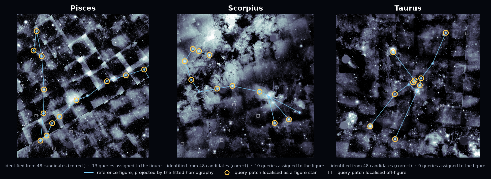
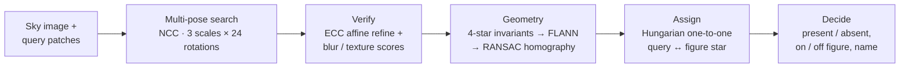
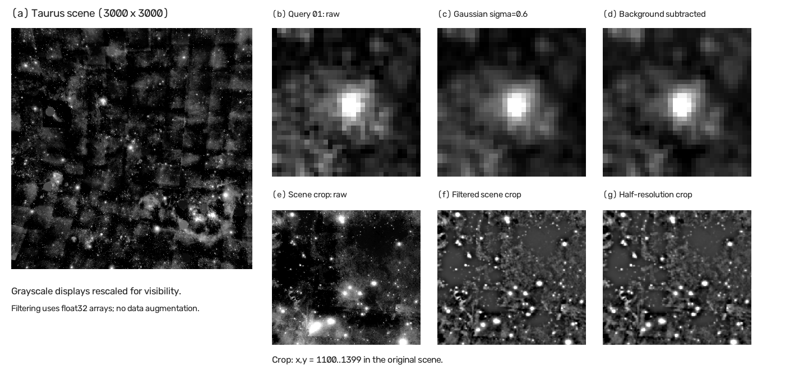
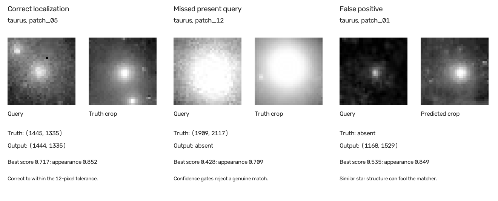

<div align="center">

# 🌌 Constellation Detection

**Find tiny star patches in a 9-megapixel sky mosaic, reject the impostors, and name the constellation — using only classical computer vision.**




<sub>The three labelled scenes. Gold rings: query patches the pipeline placed on the constellation figure. Grey squares: patches it found in the sky but off the figure. Blue: the reference figure, warped into the image by the fitted homography. All three names are identified correctly out of 48 candidates.</sub>

</div>

---

## The problem

Each scene is a **3000 × 3000 grayscale sky image** (dense star field, nebulosity, mosaic seams, instrument artefacts) plus a folder of **21–87 query patches, 32 × 32 px each**. Every patch is exactly one of three things, and you are never told which:

| Patch type | What it is | Expected output |
|---|---|---|
| **Figure star** | A star of the constellation drawn in this scene | `(x, y, 1)` |
| **Off-figure star** | A real star in this image, but not part of the figure | `(x, y, 0)` |
| **Absent** | A crop from a *different* sky | `-1` |

Every patch has been **rotated by an arbitrary angle, rescaled, sub-pixel shifted, blurred, re-lit, and corrupted with noise and compression**, so appearance alone says nothing about which category it belongs to. On top of that, each scene must be named as one of **48 constellations**, given only as schematic line drawings whose size, orientation, handedness and aspect ratio carry no relation to the sky.

The hard part: a star field is extremely self-similar. A 32 × 32 crop holds a handful of anonymous dots, and thousands of other places in the image hold a plausible handful of dots too. Local matches are weak and repetitive; only **global geometry** resolves them.

**Scoring** (averaged over scenes):

$$S = 0.25\,P + 0.20\,L + 0.25\,G + 0.30\,I$$

**P** is presence (macro-F1 over present/absent), **L** is localization (full credit within 12 px, falling linearly to zero at 36 px), **G** is geometric recovery (how many of the figure's stars were put on the map) and **I** is identification (1 if the constellation name is right).

## Results

| | Score |
|---|---:|
| **Kaggle public leaderboard** (16 hidden scenes) | **0.91146** |
| Local score on the 3 labelled scenes | 0.93226 |
| Constellations identified correctly (labelled scenes) | 3 / 3 |
| Runtime, 16 scenes on a laptop CPU | ≈ 9 min |

<details>
<summary><b>Per-scene breakdown on the labelled scenes</b></summary>

| Scene | Presence | Localization | Geometry | Identification | Score |
|---|---:|---:|---:|---:|---:|
| Pisces | 0.917 | 0.926 | 1.000 | 1.000 | 0.964 |
| Scorpius | 0.898 | 0.885 | 1.000 | 1.000 | 0.951 |
| Taurus | 0.702 | 0.778 | 1.000 | 1.000 | 0.881 |
| **Mean** | 0.839 | 0.863 | 1.000 | 1.000 | **0.932** |

Only three labelled scenes exist and all were used during development, so the local score is a sanity check, not a held-out estimate.
</details>

## How it works

The core idea: **local appearance proposes, global geometry decides.**



**1. Find candidate locations.** Scene and patches are smoothed (Gaussian σ = 1) and background-subtracted (minus a σ = 7 blur) to suppress nebulosity, then the scene is searched at half resolution. Each patch is tried at **3 scales × 24 rotations (15° steps)** with mean/variance-normalised cross-correlation, keeping the 48 best spatially distinct peaks.

**2. Refine and verify.** Every candidate is refined at full resolution with **OpenCV's ECC affine alignment** (`findTransformECC`); implausible warps are rejected. The aligned crop is then compared at five blur levels with a combined score, `0.2·intensity + 0.2·high-pass + 0.6·texture` correlation. The texture term suppresses the smooth radial profile every star shares, so the *surroundings* decide the match.

**3. Match constellation geometry.** Star centres are detected in the scene, and groups of four stars are described by **normalised triangle-area ratios**, which are affine-invariant. These are matched against the 48 reference figures through a FLANN index, and each hit proposes a transform that is refined with **RANSAC homography fitting** against further image stars. Projected figure nodes then drive a second, targeted round of patch checks that can recover queries the first search missed.

**4. Assign one-to-one.** Queries compete for projected figure nodes (within 3.5 px). A **Hungarian solver** picks the maximum-weight assignment, so two patches can never claim the same star. Weak figures (image score < 4.5 or < 75 % of stars matched) trigger a wider search with faint stars and broader hypotheses.

**5. Decide.** Patches assigned to the winning figure get `m = 1`. Others are reported as off-figure only if they pass score, appearance and margin gates (≥ 0.50, ≥ 0.65 and a gap ≥ 0.07 to the runner-up). Everything else is declared absent.

<p align="center">
  
  <br><sub>Preprocessing on Taurus: the scene, a query before and after smoothing and background subtraction, and the half-resolution search image.</sub>
</p>

### What mattered (decision-stage ablation)

Candidates and geometry held fixed; only the final decision rule changes:

| Decision rule | Score |
|---|---:|
| Full pipeline | **0.932** |
| Greedy instead of Hungarian assignment | 0.927 |
| No standalone (off-figure) matches | 0.765 |
| No geometric assignments | 0.741 |

Both halves are needed. Geometry alone finds the figure but misses off-figure stars, and appearance alone can't tell which bright dot is which.

<p align="center">
  
  <br><sub>Typical outcomes on Taurus: a match one pixel from ground truth, a real patch rejected by the confidence gate, and an absent patch fooled by a look-alike star.</sub>
</p>

## Run it

```bash
pip install -r requirements.txt

# Labelled scenes, then score them with the competition metric
python src/main.py --data path/to/participant --split train --balanced --workers 3 --output runs/train_predictions.csv
python src/evaluate.py --truth path/to/participant/train_ground_truth.csv --predictions runs/train_predictions.csv

# Hidden scenes -> Kaggle submission
python src/main.py --data path/to/participant --split validation --balanced --output runs/submission.csv
```

`participant/` is the competition data folder (`patterns/`, `train/`, `validation/`, CSVs). It isn't redistributed here. If you put it at the repository root, `--data` can be omitted. `--balanced` is the configuration that scored 0.91146. `--fast` is an experimental cheaper mode.

## Repository layout

```
src/
  main.py          scene loop: matching + geometry + decisions, writes CSV and diagnostics
  matching.py      multi-pose NCC search, ECC refinement, texture verification
  patterns.py      star detection, 4-star invariants, FLANN + RANSAC figure fitting, recovery
  assignment.py    Hungarian query-to-star assignment and figure scoring
  evaluate.py      the four competition metric components
results/           archived predictions (labelled + hidden scenes) and local metrics
tools/             script that renders the hero figure above
docs/              full technical report (PDF)
```

## Limitations and next steps

- **Look-alike stars** are the main error source, especially in Taurus (6 false positives, 4 misses out of 34 patches).
- **Speed:** about 9 minutes for 16 scenes on a laptop CPU. Spending the expensive ECC and texture checks only on uncertain queries would cut this sharply.
- **Validation:** only three labelled scenes exist, so per-component ablations of ECC, texture and faint-star recovery would need synthetic scenes.

---

<sub>Built for the Constellation Detection Kaggle competition in NYU Tandon's CS-GY 6643 Computer Vision (Fall 2026). Full write-up: [docs/technical-report.pdf](docs/technical-report.pdf).</sub>
